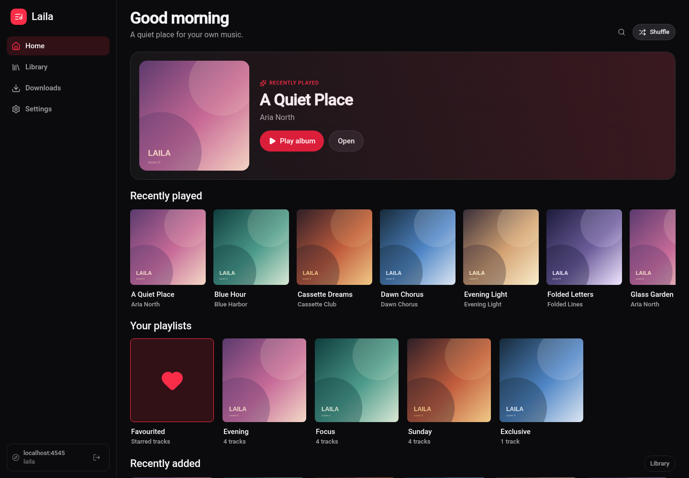
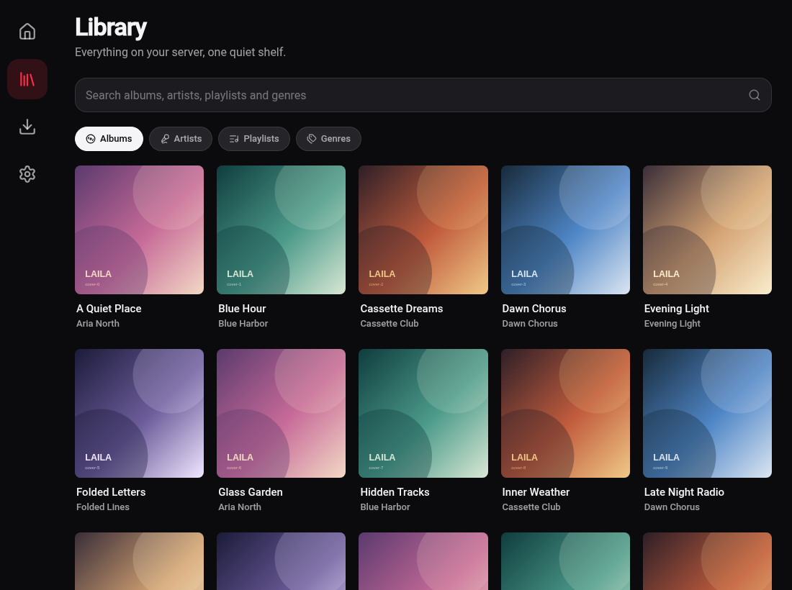
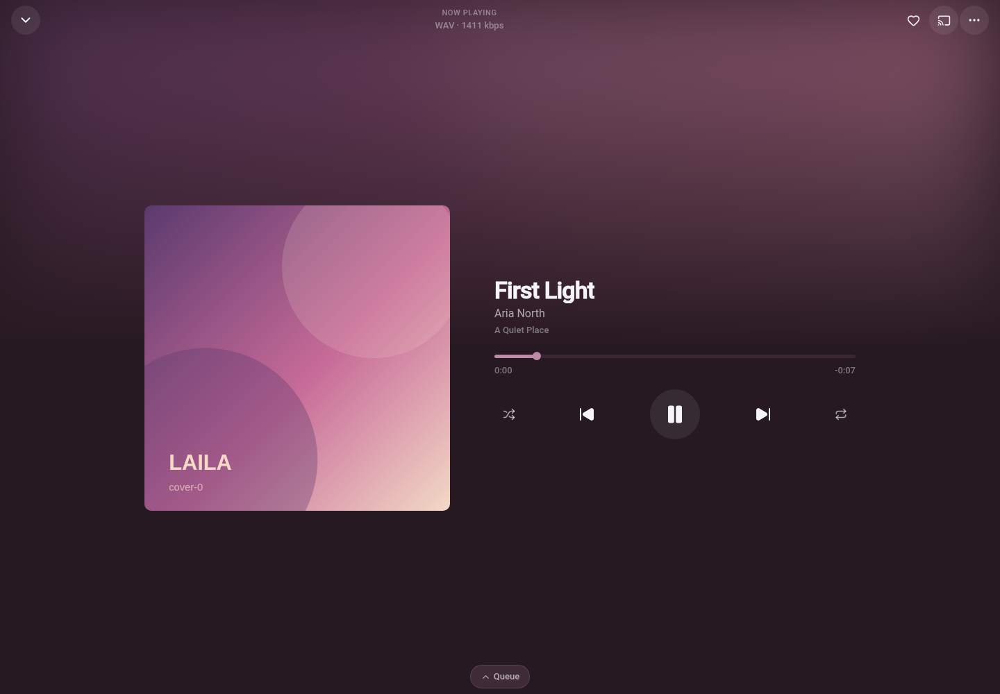

# Laila

**A self-hosted music client for Android and the web.** Built for Navidrome and
OpenSubsonic, with Segue handoff and a calm, adaptive interface inspired by
[Cassette](https://github.com/CassetteLab/cassette).

Laila talks directly to your server. No account, no cloud, no analytics and no
backend of its own.

> **Status: alpha.** Android release builds and the web export are usable today.
> There is no store release yet. See [`ROADMAP.md`](ROADMAP.md) for what is
> verified and what is still being tested.

## Screenshots

| Home | Library | Player |
|---|---|---|
|  |  |  |

Screenshots use the bundled mock server, not a real library.

## What is Laila?

Laila is a music client for people who keep their music on their own hardware.
It is **Android-first** — phone, tablet and foldable — with the same codebase
running as a web app on Linux. Firefox is the primary web target; Chromium is
supported as a secondary browser.

The interface borrows Cassette's calm organisation and Apple Music's sense of
motion, but the layout is built around window size rather than device type. One
library, one player, one queue, whether the window is a phone, a split-screen
tablet or a desktop browser.

## Why Laila?

- **Android first, not Android only.** The same screens adapt from a compact
  phone layout to a tablet rail and a desktop sidebar.
- **Segue-native.** Device discovery, remote transport, “Play on” transfer and a
  launch-time “Continue here” handoff are part of the client.
- **Offline that behaves like a library.** Downloaded albums and playlists are
  reconciled with the server, with covers, manifests and integrity checks.
- **A real queue.** Reorder, play next, shuffle, repeat, radio top-up and
  exclusions that survive across album, playlist and library playback.
- **Quiet by default.** No third-party requests at runtime, no remote fonts, no
  analytics, no error trackers.
- **Keyboard-first on the web.** Space, arrows, `n`/`p`, `s`/`r`, `f`, `q`,
  `g h`/`g l`/`g d`/`g s` and `?` for help.

## Features

### Listening

- Streaming from Navidrome or any OpenSubsonic-compatible server.
- Original FLAC and server-side transcoding to Opus or MP3.
- Play, pause, seek, previous/next, volume, repeat and shuffle.
- A persistent queue with drag reorder (Alt+↑/↓ keyboard fallback on web).
- Background playback and lock-screen/media controls on Android.
- Media Session and keyboard transport on the web.
- Lyrics: OpenSubsonic structured lyrics, LRC fallback and synced auto-scroll.

### Library

- Albums, artists, playlists, genres and favourites.
- Server-wide search plus local accent folding, pinyin and initials.
- Pinned albums, playlists and favourites on Home.
- Recently played, recently added and downloaded-only views.
- Album/playlist actions: play next, add to queue, add to playlist, pin.

### Downloads

- Offline albums, playlists and individual tracks on Android.
- Original, Opus 128 or MP3 192 downloads.
- Size estimate, free-space check and byte-size integrity verification.
- Sidecar manifests so a lost index can still recover downloaded metadata.
- Downloaded playlists reconcile when opened: new tracks are queued, removed
  tracks are cleaned up, and files are deleted only when no other collection uses
  them.

### Devices and Segue

- Segue hub discovery, device presence, remote transport and volume.
- “Play on” transfer between real devices, including queue and position.
- A launch-time “Continue here” pill for a playing or paused remote device.
- `getNowPlaying` polling fallback when no hub is configured.
- DLNA/UPnP speaker discovery and AVTransport casting on Android
  (real-device validation ongoing).

### Privacy and security

- API-key authentication preferred; token + salt supported as a fallback.
- Reverse-proxy headers for Authelia, Cloudflare Access and similar gateways.
- Credentials stay on the device; header values are never logged.
- The service worker caches only the app shell, never audio or authenticated API
  responses.
- Multi-server instances can be bound to a Wi-Fi SSID or cellular network.

## Platform support

| Platform | Status |
|---|---|
| Android phone | Primary target, release builds |
| Android tablet / foldable | Supported, window-size adaptive |
| Web on Linux (Firefox) | Supported, first-class |
| Web (Chromium) | Supported, secondary |
| iOS / iPadOS | Future, not v1 |
| macOS / Windows / native Linux | Future, not v1 |
| Android TV / Auto | Future, not v1 |
| Multi-room / stereo pairing | Out of scope for v1 |

## What's next?

- Stabilisation and efficiency: refactor and organise the existing code, and
  reduce CPU, memory, bundle and network cost. No new features until this pass is
  complete.
- Complete the Media3 device matrix (notification, lock screen, Bluetooth, audio
  focus, gapless, codecs) before a stable release.
- Real-device DLNA validation (notification sync and end-of-track advance).
- Gapless measurements on Android and Firefox.
- A full screen-reader and contrast pass.
- Signed, store-ready Android builds and a reproducible release pipeline.
- More server and codec validation against real libraries.

See [`ROADMAP.md`](ROADMAP.md) for the current, honest status.

## Segue compatibility

Segue is an upstream protocol for moving playback between a user's devices.
Laila implements the client side:

- discovers the hub next to Navidrome, or uses a manually configured hub URL;
- joins with the same media-server credentials and publishes its device state;
- shows other online devices, their current track and capabilities;
- sends `play`, `pause`, `toggle`, `stop`, `previous`, `next`, `seek`, `jump`,
  `setVolume`, `setQueue`, queue edits, repeat and shuffle;
- receives `setQueue` transfers and resumes the queue, index, position, repeat,
  shuffle order and covers;
- keeps a last-playback record for “Continue here” and for opening the app when
  another device had the music;
- falls back to `getNowPlaying` polling when there is no hub.

Important limits, by design or by the upstream hub:

- Segue's hub expects **one playing device at a time**. A party/multi-room group
  is not implemented; a hub-initiated transfer stops the other player.
- A hub restore without a requesting device is loaded **paused**, so opening the
  app never starts a track by itself.
- DLNA casting is a separate Android output path, not a Segue group.
- Jellyfin id translation and cross-API libraries are out of scope for v1.

## Requirements

- Node.js 22 and npm.
- Android Studio / Android SDK for native builds.
- A Navidrome or OpenSubsonic server.
- Optional: a Segue hub reachable from the devices.
- Web: Firefox on Linux is the reference browser.

## Quick start

```sh
npm install

# terminal 1 — mock Subsonic server + mock Segue hub
npm run mock

# terminal 2 — Expo dev server
npm run web
```

Sign in to the mock with:

- server: `http://localhost:4545`
- username: any value
- password / API key: any value

For a production-like web check:

```sh
npm run build:web
npm run serve:web   # http://localhost:4174
```

### Android release

```sh
cd android
./gradlew app:assembleRelease
```

The per-ABI APK is written to
`android/app/build/outputs/apk/release/app-arm64-v8a-release.apk`.

## Tests

```sh
npm run typecheck
npm run lint
npm run test          # Vitest
npm run test:e2e      # Playwright: desktop + mobile + one Firefox seek check
npm run test:e2e:all  # full desktop × mobile matrix
```

Current baseline: **105 unit tests**, **56 default E2E checks** (94 in the full
matrix). See [`docs/testing.md`](docs/testing.md) for coverage, codec/browser
matrices and device status. The mock server is a development fixture and never
holds real credentials.

## Architecture

Laila uses a **core / ports / adapters** split:

```text
app / components / stores
        │
        ▼
      ports  ◄──── adapters (native / web)
        ▲
        │
      core (pure)
```

- `src/core` — Subsonic, queue, offline index, Segue protocol, search and
  validation. No React, React Native, audio engine or browser imports.
- `src/ports` — interfaces for audio, storage, offline files, network and DLNA.
- `src/adapters` — native and web implementations.
- `src/stores` — Zustand state built on the pure core.
- `src/components`, `src/ui`, `app` — screens and design-system primitives.

### Stack

- TypeScript strict, Expo, React Native, React Native Web, Expo Router.
- StyleSheet + design tokens, Reanimated + Gesture Handler.
- React Query for server data; Zustand for player and local state.
- Valibot at the server boundary.
- Android audio: local Expo Media3 module (`modules/laila-player`) with a native
  media session.
- Web audio: `HTMLAudioElement` and the Media Session API.
- Images: `expo-image`; artwork palette extraction with a neutral fallback.
- Storage: atomic JSON files for app state and SecureStore for credentials on
  Android; localStorage on the web.

## Documentation

| File | Contents |
|---|---|
| [`ROADMAP.md`](ROADMAP.md) | Implemented, verified and remaining work |
| [`DESIGN.md`](DESIGN.md) | Architecture, audio, storage, Segue and UI system |
| [`STRUCTURE.md`](STRUCTURE.md) | Source layout and layer rules |
| [`docs/testing.md`](docs/testing.md) | Commands, test matrices and device status |
| [`docs/changelog.md`](docs/changelog.md) | Dated implementation history |
| [`docs/performance.md`](docs/performance.md) | Library profiling and the windowed web grid |
| [`docs/csp.md`](docs/csp.md) | Web content-security notes |
| [`docs/accessibility.md`](docs/accessibility.md) | Keyboard and screen-reader notes |
| [`docs/dlna.md`](docs/dlna.md) | DLNA/UPnP discovery and casting |
| [`docs/server-switching.md`](docs/server-switching.md) | Wi-Fi/cellular server instances |
| [`CONTRIBUTORS.md`](CONTRIBUTORS.md) | People and tools that shaped Laila |

## Contributing

Small fixes and focused pull requests are welcome. Before a larger change,
open an issue or discussion first. Keep the core pure, avoid new dependencies
unless they replace something substantial, and run typecheck, lint, unit tests
and the default E2E suite before opening a PR.

## License

Laila is released under the MIT License. See [`LICENSE`](LICENSE) for the full
text.

The Android audio engine is built on AndroidX Media3, which is licensed under
Apache-2.0.

## Acknowledgments

- [Navidrome](https://www.navidrome.org) and the
  [OpenSubsonic](https://opensubsonic.netlify.app) community, for the server and
  API that make this possible.
- [Cassette](https://github.com/CassetteLab/cassette), for the organisation and
  presentation ideas that shaped the interface.
- The Segue protocol and hub authors, for the device-handoff model.
- The Expo, React Native, Reanimated and React Native Web communities.
- DeepSeek and OpenCode, for AI pair-programming and agent tooling during
  development.
